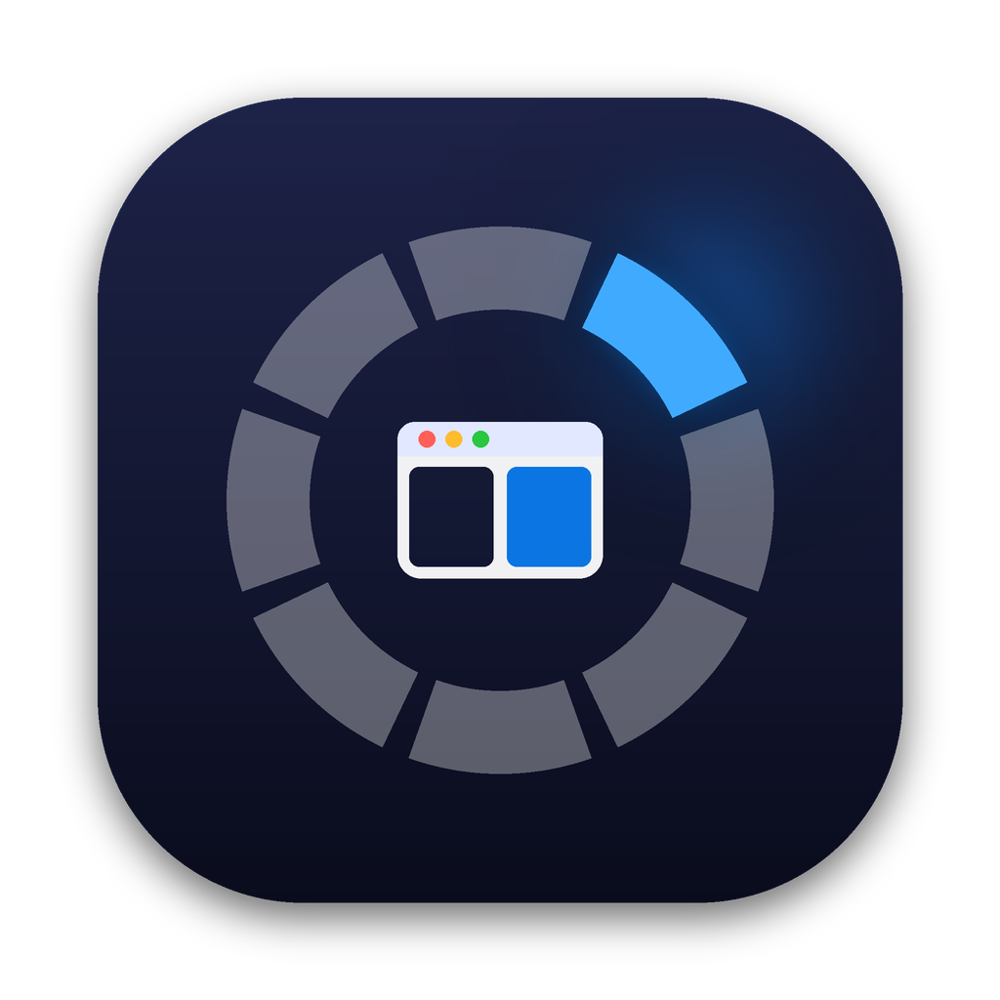

<p align="center">
  
</p>

<h1 align="center">Swoop</h1>

<p align="center"><b>Window management with a flick.</b><br>
Hold a key, flick the mouse toward where a window should go, let go. Done.</p>

<p align="center">
  <a href="https://github.com/iam8uman/swoop/releases/latest/download/Swoop.zip"><b>Download for macOS</b></a> ·
  <a href="https://swoop-mac.vercel.app">Website</a> ·
  macOS 13+ · Apple silicon & Intel · Free & open source (MIT)
</p>

---

## Features

- **Radial menu.** Hold the trigger key (Right ⌥ by default) and move the cursor in a direction. Release to snap the window there. It works without looking, and a ring at the cursor shows what you'll get.
- **Live preview.** An outline shows exactly where the window will land before you commit.
- **Keyboard shortcuts.** Hold the trigger and press a key: ← → ↑ ↓ for halves, ↩ to maximize, C to centre, 1–4 for quarters, [ ] to change screens, and more. Every key can be rebound.
- **Cycles.** Press the same key again, or click while holding the trigger, to step through a direction: Right Half → Right Third → Right Two Thirds.
- **Stash.** Tuck a window behind the screen edge, leaving a sliver. Push the cursor against the edge to slide it out.
- **Every layout you'd expect:**
  - Maximize, Almost Maximize, Fullscreen, Centre, macOS Centre
  - Halves, quarters, horizontal and vertical thirds
  - Next, previous, left, right, top and bottom screen
  - Larger, Smaller, Grow and Shrink each edge, Move
  - Undo, Initial Frame, and your own **custom layouts**
- **Theming.** Change the radial menu's size, thickness, shape (circle or rounded square) and colour, and the preview's padding, corners, border and fill. It follows your macOS accent colour by default.
- **Automation** with the `swoop://` URL scheme. It works from Terminal, Shortcuts, Raycast, Alfred and BetterTouchTool.
- Smooth animations, gaps between windows, haptic feedback, ignored apps, launch at login, and import/export of settings.
- **Private.** It needs only the Accessibility permission. There's no account, no network and no telemetry.

## Install

1. [Download Swoop.zip](https://github.com/iam8uman/swoop/releases/latest/download/Swoop.zip), unzip it, and drag **Swoop** into **Applications**.
2. Open it. Swoop isn't notarized yet, so macOS will warn you the first time:
   - **macOS 15+:** open **System Settings → Privacy & Security**, scroll down, and click **Open Anyway** next to Swoop.
   - **macOS 13–14:** right-click Swoop → **Open** → **Open**.
   - Or in Terminal: `xattr -dr com.apple.quarantine /Applications/Swoop.app`
3. Allow **Accessibility** when asked (System Settings → Privacy & Security → Accessibility → Swoop).
4. Hold **Right ⌥** and flick the mouse. 🎉

## Default controls

| While holding the trigger | Does |
|---|---|
| Move the cursor | Pick a direction on the ring |
| Click | Next step in the cycle |
| Release | Apply |
| Esc / right-click | Cancel |
| ← → ↑ ↓ | Halves → thirds → two-thirds (cycle) |
| ⇧ + arrows | Move the window |
| ↩ | Maximize → Almost Maximize |
| C | Centre → macOS Centre |
| F | Fullscreen |
| T | Centre third |
| 1 2 3 4 | Quarters |
| [ ] | Previous / next screen |
| = − | Larger / smaller |
| , . / | Stash left / stash right / unstash |
| Z / I | Undo / initial frame |
| M / H | Minimize / hide app |

Typing normally while holding the trigger is never blocked. Keys that aren't Swoop shortcuts pass straight through.

## Automation

```bash
open -g "swoop://action/maximize"
open -g "swoop://action/right-two-thirds"
open -g "swoop://screen/next"
open -g "swoop://direction/top-left"     # whatever that direction does on your ring
open -g "swoop://custom/Writing%20Mode"  # your own layout
open -g "swoop://stash/right"

# chain them
open -g "swoop://action/left-half" && sleep 0.3 && open -g "swoop://screen/next"

# list everything
/Applications/Swoop.app/Contents/MacOS/Swoop --list
```

## Build from source

You need Xcode 15 or later on macOS 13 or later.

```bash
git clone https://github.com/iam8uman/swoop.git
cd swoop
swift test                    # core logic tests
./scripts/build-app.sh        # → build/Swoop.app
open build/Swoop.app
```

To develop in Xcode, run `open Package.swift`. URL schemes and launch at login need the bundled app from `build-app.sh`.

Releases are automatic. Bump `CFBundleShortVersionString` in `Resources/Info.plist` and push to `main`, and GitHub Actions tests, builds and smoke-tests a universal `Swoop.zip`, then publishes it as release `v<version>`. Pushing a `v*` tag does the same.

### Project layout

```
Sources/SwoopCore   Pure logic: actions, geometry, radial math, cycles, settings, URL commands (unit-tested)
Sources/Swoop       The app: Accessibility, trigger key event tap, radial menu, preview, stash, settings UI
website/            Landing page (static, deployed on Vercel)
```

## FAQ

**Why does it need Accessibility?** macOS only lets apps move other apps' windows through the Accessibility API. Swoop uses it for that and nothing else.

**Do I have to grant permission again after updating?** Builds aren't signed with a Developer ID yet, so macOS may ask again after an update. Remove Swoop from the Accessibility list and add it back.

**Can I use Caps Lock as the trigger?** Remap Caps Lock to Control in System Settings → Keyboard → Modifier Keys, then choose Right Control in Swoop. You can also use Hyperkey or Karabiner-Elements.

## License

MIT © 2026 Suman Sharma ([@iam8uman](https://github.com/iam8uman)). Inspired by radial window managers like [Loop](https://github.com/MrKai77/Loop). Swoop is an independent implementation with no shared code.
